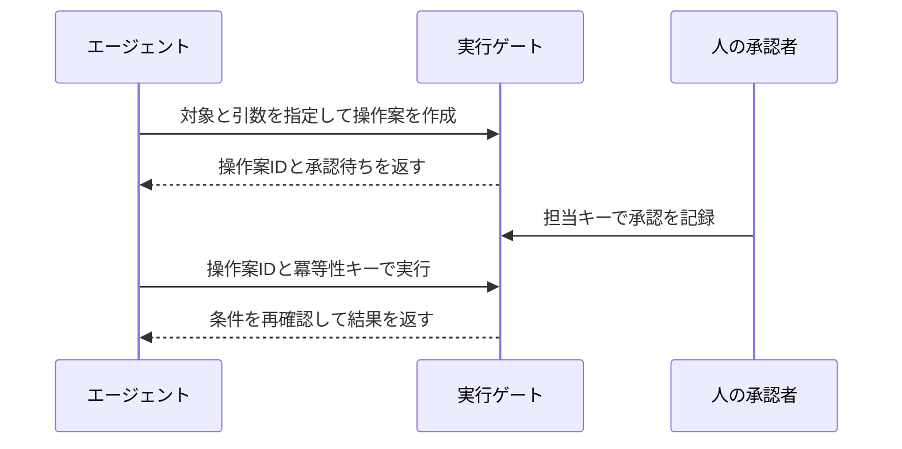

# Motor Factory Lab 操作・デモガイド

Motor Factory Labは、小型モーター `M-100` の組立ラインを題材にしたAIエージェントのテストベンチです。SCADA風の画面で設備を観測し、Level 3の製造運用とLevel 4の生産計画を模した操作を試せます。停止、承認待ち、保全、再開を一つの異常シナリオで追えます。

## 起動と画面の見方

Python 3.9以上で、プロジェクトの親フォルダから実行します。

```sh
cd motor_factory_lab
python3 server.py --demo
```

ブラウザで監視画面を開きます。シミュレーションはサーバーで進み、画面が約1.5秒ごとに状態を取得します。初回起動時の時計は5倍速です。再起動時は保存済みの状態から再開します。[監視画面を開く](http://127.0.0.1:8765)

| 画面 | 確認・操作できること |
|---|---|
| **ライン監視** | 工程ミミック、警報、良品・不良数、仕掛品、在庫、指図進捗。設備を選ぶと温度、処理時間、シリアル番号を確認できます。 |
| **エージェント実験** | 操作案の作成、呼出し結果、実行、監査タイムライン。手入力とルールベースの見本を試せます。 |
| **人の承認** | 担当ロールで接続して操作案の対象・引数・影響・期限を確認し、承認または却下します。 |
| **I/F・設計** | Level 3／4との境界、公開ツール、REST・MCPの接続先を確認できます。 |

単独で開ける `scada_preview.html` は、4種類の固定スナップショットを切り替える画面見本です。時計、操作案、認証、承認を試す場合はサーバー版を開きます。[画面プレビュー](../scada_preview.html)

## 工場とラインの構成

工場は1本の組立ライン `LINE-01`、モーターキット在庫 `MOTOR-KIT`、2件の製造指図を持ちます。キットを1セット消費すると、指図IDとシリアル番号を持つ1台がS01へ投入されます。

| 順序 | 設備 | 工程 | 1台の処理時間 |
|---:|---|---|---:|
| 1 | S01 | 部材供給 | 12秒 |
| 2 | S02 | ステータ巻線 | 24秒 |
| 3 | S03 | 回転子・軸受 | 18秒 |
| 4 | S04 | ハウジング組付 | 20秒 |
| 5 | S05 | ボルト締付 | 16秒 |
| 6 | S06 | EOL検査（ライン終端検査） | 26秒 |

各設備は先頭の1台を処理します。処理中の台を含め、各工程の仕掛品（WIP）は最大3台です。処理が終わっても次工程が満杯なら、画面は「搬送待ち」と表示します。複数の工程が同時に動くため、1台が全工程を通る処理時間の合計116秒と、ラインが埋まった後の排出間隔は異なります。最長のS06が、定常時の理想排出間隔を26秒に制約します。

S05で締付トルクを記録し、S06で製品基準の `4.2 ± 0.35 N·m` と比較します。正常時のレシピは4.2 N·mで、測定値には小さなばらつきがあります。モデルにはトルク以外の基礎不良もあり、正常シナリオでも不良が出ることがあります。検査済みの良品と不良の両方を指図の処理実績に数えます。

| 模擬する階層 | このアプリで扱うもの |
|---|---|
| Level 1／2 | 工程キュー、温度、締付、搬送、インターロック。設備状態として画面に表示します。 |
| Level 3（MES） | ライン状態、アラーム、品質、停止・再開、レシピ、保全。 |
| Level 4（ERP） | 指図のリリース、投入優先度、部材在庫、補充と入荷。 |

SCADA画面の緑は加工中、黄は搬送待ちや工具ドリフト、赤は設備故障、灰は待機・停止を示します。アラーム帯には異常の種類と件数が出ます。通信が途切れると `COMMS LOST` と `STALE DATA` が表示され、設備欄の値は最終受信時点のものとして読めます。OEEはシミュレーションの稼働率・性能・品質から算出する参考値です。

## 通常運転を観察する

初期状態の在庫は160セットです。`WO-2601` は80台、優先度3、リリース済みです。`WO-2602` は60台、優先度2、計画中です。

1. 「ライン監視」を開きます。`WO-2601` の部材がS01に入り、時間とともにS02からS06へ流れます。在庫は投入時に減ります。
2. 工程を選び、同じシリアル番号が下流へ移ることを確認します。初期状態から時計を117秒進めると、最初の1台がS06の検査を終えます。5倍速では約24秒です。
3. 検査終了ごとに良品または不良が増えます。80台の検査が終わると `WO-2601` は「完了」です。後続を投入するには `WO-2602` のリリースが必要です。
4. 後続の投入も試す場合は、「エージェント実験」で「製造指図をリリース」、対象 `WO-2602`、引数 `{}` の操作案を作ります。生産計画担当者が承認し、エージェント側で実行すると、次の投入候補に加わります。複数の指図がリリース済みの場合は、優先度の数値が大きい方が先に投入されます。

初期状態からやり直すときは、現場責任者として接続し、「ライン監視」の `↺` を押します。同じ乱数seedで工場が初期化され、未実行の操作案は無効になります。監査ログは残ります。

| 画面の操作 | 変わるもの |
|---|---|
| 時計を停止・再開 | 仮想時間が自動で進むかどうか。停止中も `+60秒` で手動進行できます。 |
| 速度（1×／5×／20×／60×） | 実時間1秒あたりの仮想時間の進み方。 |
| ラインを一時停止・再開 | 製造設備の処理と搬送。ライン停止中も時計を進めれば、入荷予定は進みます。 |
| シナリオを適用 | 異常や欠品の注入。通常運転を選ぶと注入した異常状態・警報を解除します。停止したラインの再開や欠品分の補充は別の操作です。 |

## 「人のキーで接続」とは

人のキーは、サーバーがローカルの試験用に発行するロール別のBearerキーです。接続すると、画面は入力されたキーをサーバーに照会して担当ロールを確認します。同じ利用者が一つの画面でエージェント役と承認者役を試せるよう、エージェントの呼出し用キーと人の承認用キーを分けています。

サーバー起動後、別のターミナルで同じ `motor_factory_lab` フォルダを開き、試したい役のキーを取得します。

```sh
python3 credentials.py supervisor
python3 credentials.py planner
```

1. 目的のコマンドが表示した1行をコピーします。
2. 画面右上の「人のキーで接続」を開き、「開発用Bearerキー」に貼り付けます。
3. 「認証して接続」を押し、右上に `現場責任者 · supervisor-01` または `生産計画担当者 · planner-01` が出たことを確認します。
4. ロールを切り替えるときは、右上の同じボタンを開いてもう一方のキーを入力します。画面を再読み込みした後は、人のキーを再入力します。

| キー | 主な用途 |
|---|---|
| `agent` | 観測、操作案の作成、許可を満たした案の実行。`--demo` では画面が自動取得します。外部エージェントには `python3 credentials.py agent` で取得した値を渡します。 |
| `supervisor` | Level 3の承認・却下、実験シナリオの注入、時計・速度・初期化。 |
| `planner` | Level 4の承認・却下。 |
| `viewer` | 読み取り用のAPIアクセス。 |

キーは起動時に生成される `.runtime/credentials.json` に保存されます。`--data-dir` を指定した場合は、キー取得コマンドにも同じ `--data-dir` を指定します。このディレクトリは `.gitignore` で除外されており、コミットしてはいけません。キーを作り直すときはサーバーを停止して `.runtime` を削除し、再起動します。画面は人のキーをそのページのメモリに保持します。サーバーが確認するのはキーにひも付いた試験ロールです。同じOSアカウントで動くプログラムは資格情報ファイルを読めるため、エージェントと人を別環境で隔離する用途には、OS側の権限分離や外部の本人認証が必要です。

## 許可される操作

読み取りツールは、認証済みのキーで呼び出せます。工場状態を変える操作は、下表の対象・引数・事前条件で操作案を作成し、サーバーが実行時に再判定します。

| 画面の操作 | 操作ID | 対象と引数の例 | 条件・承認者 |
|---|---|---|---|
| ラインを一時停止 | `mes.pause_line` | `LINE-01`、`{}` | 自動許可。操作案を作ってから実行。 |
| ラインを再開 | `mes.resume_line` | `LINE-01`、`{}` | S03の設備異常が解除済み。現場責任者。 |
| 締付レシピを変更 | `mes.set_torque` | `LINE-01`、`{"torque_nm": 4.2}` | 停止中、設定値3.8〜5.5 N·m。現場責任者。 |
| 保全作業を実施 | `mes.maintenance` | `LINE-01`、`{"station_id": "S03"}` | 停止中、対象設備はS03またはS05。現場責任者。 |
| 製造指図の優先度を変更 | `erp.set_priority` | `WO-2602`、`{"priority": 5}` | 整数1〜5。次回以降の投入選択に反映。生産計画担当者。 |
| 部材補充を手配 | `erp.replenish` | `MOTOR-KIT`、`{"quantity": 80}` | 整数10〜300セット。仮想時間60秒後に入荷。生産計画担当者。 |
| 製造指図をリリース | `erp.release_order` | `WO-2602`、`{}` | 対象が計画中。生産計画担当者。 |

レシピの設定範囲と製品の検査合格範囲は別です。承認済みのレシピ変更は以後の締付に適用され、検査は製品基準 `4.2 ± 0.35 N·m` を使います。PLCへの直接書込みや品質判定の上書きは操作カタログの対象外です。

## エージェント実験と承認の流れ

1. 「エージェント実験」で操作・対象・JSON引数を選び、「操作案を作成」を押します。`factory_preflight` が条件と影響を確認し、操作案IDを返します。
2. 自動許可なら「自動許可の操作を実行」へ進みます。承認待ちなら、担当の人のキーで接続し、「人の承認」で対象・引数・期限を確認します。理由を3〜500文字で入力して「内容を確認して承認」または「却下」を押します。
3. 承認後は「エージェント実験」に戻り、「承認済みの操作を実行」を押します。`factory_execute` が再判定して工場に反映し、「呼出し結果」に `EXECUTED` が出ます。
4. 「ライン監視」で反映結果を、「監査タイムライン」で提案・承認・実行・拒否の記録を確認します。



操作案は提案者・操作・対象・引数・関連する状態バージョンにひも付きます。期限は**仮想時間ではなく実時間5分**です。新たな設備警報や指図の状態遷移など、関連する条件が変わった案は、もう一度作成して承認を取り直します。同じ提案者が同じ冪等性キーで再試行すると、元の実行結果が返ります。

「次の一手（ルール）」はサーバーの状態を読んで動くルールベースの見本です。実行可能な操作案があれば実行し、承認待ちがあれば待機します。新たな操作を判断する場合、軸受過熱ではS03保全、工具ドリフトでは停止してS05保全、欠品では補充を提案します。停止中は再開を提案し、通常運転で後続指図が計画中ならリリースを提案します。特定の手順だけを見せたいときは手入力で操作案を作ります。

「自己承認の拒否を試す」を押すと、エージェントのキーで承認を要求します。呼出し結果の `FORBIDDEN` と監査ログの `denied` が、サーバーで拒否されたことを示します。

## デモ用シナリオ

各デモは、前の試験の未実行案がない状態から始めます。手順を追いやすくするには、現場責任者で `↺` を押し、必要に応じて「時計を停止」と `+60秒` を使います。異常を入れるときは「ライン監視」の最下部でシナリオを選び、「シナリオを適用」を押します。

| デモ | 注入直後の見どころ | 復旧の操作と担当 |
|---|---|---|
| 工具ドリフト +0.9 N·m | `TORQUE_DRIFT`、S05の警告。ドリフト後に締めた台がS06に届くと `TORQUE_NG` が発生。 | 一時停止 → S05保全 → 再開。保全と再開は現場責任者。 |
| 軸受過熱 / 自動停止 | `BEARING_HEAT`、S03が82 ℃、ライン停止、`INTERLOCK ACTIVE`。 | S03保全 → 再開。両方とも現場責任者。 |
| 部材欠品 | `MATERIAL_LOW`、在庫0、新規投入が停止。工程内の台は処理を継続。 | 80セットの補充を生産計画担当者が承認 → エージェントで実行 → 仮想時間60秒後に入荷。 |

### A. 工具ドリフトで品質低下を観測する

1. 初期化後、ラインを稼働させた状態で「工具ドリフト +0.9 N·m」を適用します。S05の警告を確認します。
2. 時計を進め、ドリフト中に締めた台が検査を終えるまで待ちます。初期状態からなら `+60秒` を2回押すと、最初の検査結果を観察できます。
3. 「次の一手（ルール）」を押します。稼働中なら停止を実行したうえで、`mes.maintenance` のS05保全案を作成します。現場責任者で承認し、エージェント側で実行します。
4. 再開案を作成し、現場責任者の承認後に実行します。すでに締付を終えた仕掛品の検査や累積不良数を見ながら、保全後に処理した台の結果と区別します。

### B. 軸受過熱でインターロックと承認を確認する

1. 「軸受過熱 / 自動停止」を適用します。S03の詳細と警報帯を確認します。
2. 先に「ラインを再開」の操作案を作ると、`INTERLOCK` が返ります。続けて「保全作業を実施」、対象 `LINE-01`、引数 `{"station_id":"S03"}` の案を作ります。
3. 現場責任者で保全を承認し、エージェント側で実行します。警報と起動禁止の解除を確認します。ラインは停止状態なので、別に再開案を作成・承認・実行します。

### C. 欠品から補充までLevel 4を試す

1. 稼働中に「部材欠品」を適用します。在庫0と新規投入停止を確認します。
2. 「部材補充を手配」を選び、対象 `MOTOR-KIT`、引数 `{"quantity":80}` の操作案を作ります。操作案に仮想の手配額256,000円と入荷まで60秒が表示されます。
3. 生産計画担当者のキーに切り替え、承認します。「エージェント実験」に戻り、承認済みの案を実行します。
4. 時計を進め、入荷待ちが消えて `MATERIAL_LOW` が解除されることを確認します。手動で進める場合は、現場責任者のキーに戻して `+60秒` を押します。稼働中で投入可能な指図が残っていれば、入荷直後からキットを消費するため、表示在庫は80を下回ることがあります。

## 外部エージェントから接続する

画面のエージェント実験は、サーバーの公開ツールを使う接続見本です。外部のルールエンジンやLLMを接続するときも、観測、案作成、承認状態の確認、実行の順に同じツールを呼び出します。

| 用途 | ツール |
|---|---|
| 設備、仕掛品、品質、警報を取得 | `mes_get_snapshot` |
| 指図、在庫、入荷予定を取得 | `erp_get_orders`、`erp_get_inventory` |
| 操作・引数・担当ロールを確認 | `factory_get_policy` |
| 操作案を作成・照会 | `factory_preflight`、`factory_list_proposals` |
| 実行・監査結果を確認 | `factory_execute`、`factory_get_audit` |

RESTは `POST /api/tool`、MCPは `POST /mcp` です。各要求に `Authorization: Bearer <agent key>` を付けます。RESTの操作案作成と実行の本文例は以下のとおりです。

```json
{"name":"factory_preflight","arguments":{"action":"mes.pause_line","target":"LINE-01","arguments":{}}}
```

```json
{"name":"factory_execute","arguments":{"proposal_id":"<返された操作案ID>","idempotency_key":"demo-pause-001"}}
```

人の判断は別経路の `POST /api/approval` に、担当の人のキーを添えて送ります。ブラウザの「人の承認」画面がこの経路を使います。通信は要求単位で認証するstatelessな設計で、工場状態・承認・実行履歴はサーバーのSQLiteに保存されます。MCPのヘッダー、stdioアダプタ、開発用の起動設定はREADMEに記載しています。[エージェント接続の詳細](../README.md#エージェント接続)
